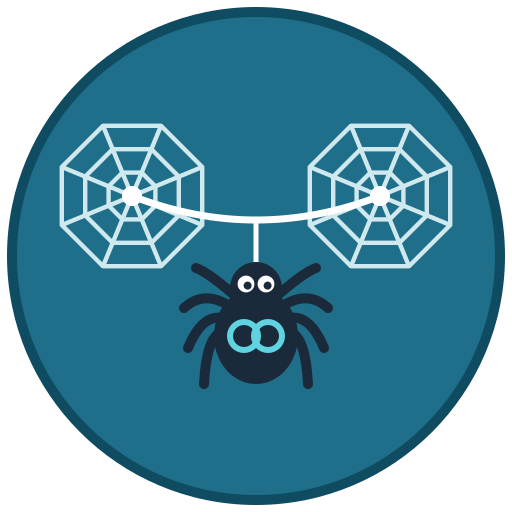

<div align="center">
  

  <h1>Router Peering</h1>

  <p><strong>VPC-style peering between OpenStack routers in different projects, with request and accept.</strong></p>

  <p>
    <a href="LICENSE"></a>
    <a href="https://github.com/zufardhiyaulhaq/openstack-router-peering/actions/workflows/ci.yml"></a>
    <a href="backend/go.mod"></a>
    <a href="https://github.com/zufardhiyaulhaq/openstack-router-peering/pkgs/container/router-peering"></a>
  </p>

  <p>
    <a href="docs/superpowers/specs/2026-10-23-router-peering-design.md">Design</a> ·
    <a href="frontend/README.md">Horizon plugin</a> ·
    <a href="deploy/kolla/horizon/README.md">Deploy on Kolla</a>
  </p>
</div>

---

Router Peering brings the AWS / GCP / Alibaba Cloud style of VPC peering to OpenStack. A router is the
VPC: project A asks to peer one of its routers with a router in project B, project B accepts, and the
service connects the 2 routers through a private transit network. Users add their own routes and security
group rules, the same as on a public cloud.

Tenants only need the `member` role. Every cross-project Neutron change is made by the service's own
account, and only after the other side accepts, so no project ever needs access to another project.

## ✨ Features

- **Request and accept**: the requester names the peer project and the peer router; nothing is built
  until the accepter confirms. Requests expire after 7 days.
- **Neutral transit network**: a `/29` network owned by the service project, invisible to both tenants.
  Tenants cannot boot VMs on it or detach it.
- **Overlap protection**: accept is refused when the 2 sides' subnets overlap, including subnets of
  routers already peered with either side.
- **Safe delete**: a peering cannot be removed while a route still uses its next hop.
- **Self-healing**: a reconciler retries Neutron work, cancels requests whose router disappeared, flags
  overlaps that appear later, and cleans up orphans.
- **No data-path component**: an active peering is plain Neutron router ports. If the service is down,
  existing peerings keep forwarding traffic.
- **Horizon panel**: Project → Network → Router Peering, with Outgoing, Incoming and History tabs.

## 🔁 How it works

```
 project A                                                     project B
 VM 10.91.0.10                                                 VM 10.92.0.10
   │                                                             │
 router A ── 100.64.0.1 ═══ transit network rpx-<id> ═══ 100.64.0.2 ── router B
   route: 10.92.0.0/24 via 100.64.0.2             route: 10.91.0.0/24 via 100.64.0.1
```

| # | Who | Action | Status after |
|---|---|---|---|
| 1 | Requester (project A) | Names its router, B's project ID and **B's router ID** | `pending_acceptance` |
| 2a | Accepter (project B) | Confirms; refused (409) if the CIDRs overlap | `provisioning` → `active` |
| 2b | Accepter | Rejects | `rejected` |
| 2c | Requester | Cancels before B answers | `cancelled` |
| 2d | Nobody, 7 days | — | `expired` |
| 3 | Both users | Add a route via the `next_hop` shown on the peering, and security group rules | stays `active` |
| 4 | Either side | Deletes (blocked until routes via the next hop are removed) | `deleting` → `deleted` |

Each side shares its project ID (`openstack token issue -c project_id`) and router ID out of band.

## 📦 Prerequisites

- OpenStack with Keystone v3 and Neutron (ML2/OVN tested; ML2/OVS uses the same API).
  Neutron extensions: `router`, `extraroute`, `standard-attr-tag`, `port-security`.
- PostgreSQL 16 (the compose file runs one).
- Go 1.25+ to build the backend; Docker to run the plugin tests.
- A free transit range, default `100.64.0.0/16`, used by no subnet, CNI or provider network.

## 🚀 Building

```bash
cd backend && make build
```

or the container image:

```bash
docker build -t router-peering backend
```

CI publishes `ghcr.io/zufardhiyaulhaq/router-peering` (amd64 + arm64) as `:latest` and `:sha-<short>` on
every push to `main`, and `:X.Y.Z` / `:X.Y` on `vX.Y.Z` tags. Pin a `sha-` or version tag in production.

## ⚙️ Configuration

One YAML file plus 2 secrets from the environment. See
[`deploy/kolla/router-peering.yaml.example`](deploy/kolla/router-peering.yaml.example) for every key.

| Setting | Default | Description |
|---|---|---|
| `listen` | `:9797` | API address. Behind HAProxy, use the host's own IP (see the example file). |
| `keystone.auth_url` | — | Keystone v3 URL for the service account (required) |
| `transit_pool` | `100.64.0.0/16` | Split into `/29` blocks, one per peering |
| `roles.*` | `member` (`view`: `reader`) | Keystone role each action needs |
| `max_non_terminal_per_project` | `50` | Open peerings a project may request or hold |
| `pending_ttl` | `168h` | How long a request waits for accept |
| `RP_DATABASE_URL` (env) | — | Postgres URL (required) |
| `RP_KEYSTONE_PASSWORD` (env) | — | Service account password (required) |

The binary runs as `router-peering api`, `router-peering reconciler` or `router-peering migrate`.
Migrations also run at startup.

## 🧩 API

`X-Auth-Token` must be a project-scoped Keystone token.

| Method | Path |
|---|---|
| `POST` | `/v1/peerings` `{name, router_id, peer_project_id, peer_router_id}` |
| `GET` | `/v1/peerings?direction=incoming\|outgoing&status=…&sort=newest&limit=&marker=` (cloud admin: `&all_projects=true`) |
| `GET` | `/v1/peerings/{id}`, `/v1/peerings/{id}/events` |
| `POST` | `/v1/peerings/{id}/accept` (no body), `/reject`, `/repair` |
| `DELETE` | `/v1/peerings/{id}` |
| `GET` | `/healthz`, `/readyz` |

## ☁️ Deploying on Kolla-Ansible

Everything runs as plain containers; Kolla does not manage them.

1. **Check the transit range is free.** The service reserves blocks that overlap Neutron subnets, but it
   cannot see anything outside Neutron.
2. **Register in Keystone** (once, with admin credentials):
   ```bash
   RP_PASSWORD=... RP_PUBLIC_URL=http://<host>:9797 RP_INTERNAL_URL=http://<host>:9797 deploy/kolla/register.sh
   ```
   Each peering uses 1 network and 1 subnet of the `service` project's quota (default 100 each).
3. **Configure.** Copy `deploy/kolla/` to the host (e.g. `/opt/router-peering`), create
   `router-peering.yaml` from the example, and write `.env` with `ROUTER_PEERING_IMAGE`,
   `POSTGRES_PASSWORD`, `RP_DATABASE_URL` and `RP_KEYSTONE_PASSWORD`.
4. **Start.** `docker compose up -d`. Postgres listens on loopback only unless `RP_DB_LISTEN` is set.
5. **Horizon panel.** Follow [`deploy/kolla/horizon/README.md`](deploy/kolla/horizon/README.md): mount the
   plugin into the stock Horizon container, or build a custom image.
6. **Optional HA.** Run `api` and `reconciler` on more hosts against the same database and add
   [`haproxy/router-peering.cfg`](deploy/kolla/haproxy/router-peering.cfg) to Kolla's HAProxy.
7. **Back up** the `router_peering` database nightly with `pg_dump`.

## 🧪 Running Tests

```bash
make -C backend test       # unit tests (database tests skip)
make -C backend test-db    # starts postgres:16 in Docker and runs every backend test
make -C frontend test      # Horizon plugin tests inside the Kolla Horizon image
```

The end-to-end suite in [`backend/test/e2e/`](backend/test/e2e/README.md) runs against a real cloud:
2 projects, 2 VMs, a ping across the peering, delete, cancel, reject and repair.

## 📁 Layout

| Path | What |
|---|---|
| `backend/` | Go service: API, reconciler, migrations, Dockerfile, unit and e2e tests |
| `frontend/` | Horizon plugin |
| `deploy/kolla/` | compose file, Keystone registration, config example, HAProxy and Horizon delivery |
| `docs/` | design specs, plans, logo |

## 📄 License

Apache-2.0. The spider mascot in `docs/assets/` is original artwork for this project.
